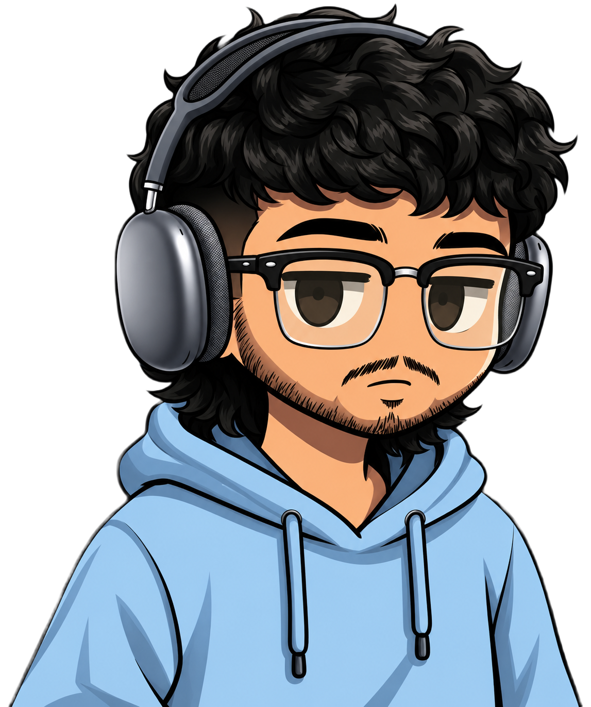

# 

  

  

  
  
  
  

<h2 align="center">Tools & Software</h2>

  
  
  
  
  
  

<!--<h2 align="center">Showreel</h2>

  

-->

<h2 align="center">About Me</h2>

<table align="center">
  <tr>
    <td width="30%" align="center"></td>
    <td align="center">
 Hi, I’m <strong>Surya</strong> — a Computer Science student passionate about both programming and visual storytelling. I work with Python and C, and I’m currently exploring HTML and UI/UX design while continuing to create cinematic visuals and digital art. I enjoy blending technical skills with creativity, building immersive experiences, and turning ideas into polished work.
    </td>
  </tr>
</table>

<h2 align="center">V E N I &nbsp;·&nbsp; V I D I &nbsp;·&nbsp; V I C I</h2>

  <strong>I CAME.</strong> 
  <strong>I SAW.</strong> 
  <strong>I CONQUERED.</strong>  
  <i>“Veni, vidi, vici.”</i>

<h2 align="center">GitHub Activity</h2>

  
  

<h2 align="center">Featured Repositories</h2>

  
  

  <a href="https://github.com/suryavellingiri18-tech?tab=repositories">View all repositories</a>

<h2 align="center">Goals</h2>

  <i>To build immersive visual experiences, sharpen my craft in VFX and design, and grow into a multidisciplinary artist who blends storytelling, motion, and technology.</i>

  • Master cinematic VFX and compositing workflows 
  • Strengthen storytelling through motion design and visual direction 
  • Build a polished portfolio of artistic and technical work 
  • Turn creative passion into impactful, professional projects

